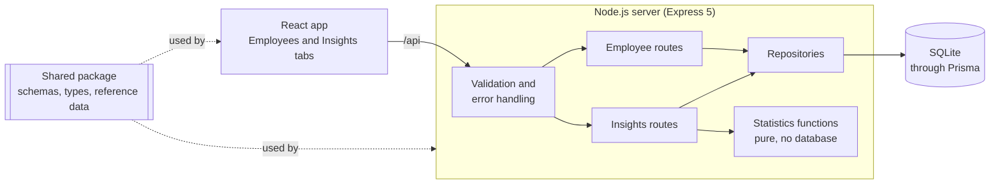
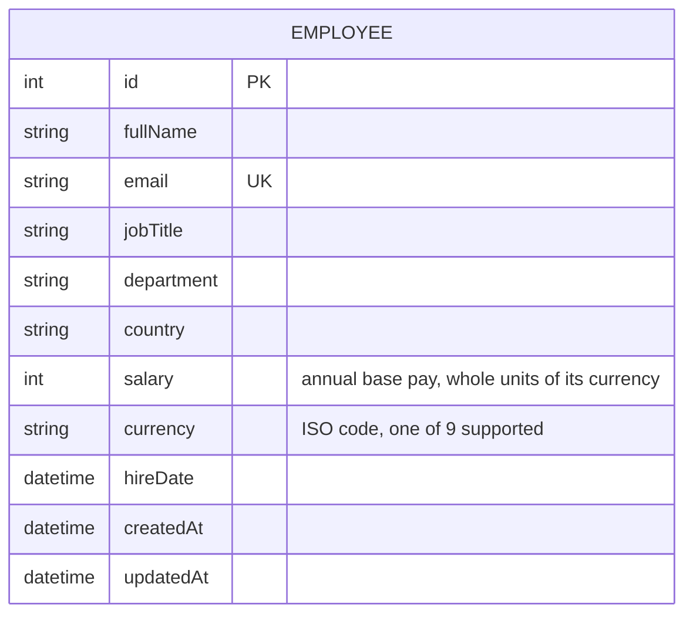

# Design notes

How the app is put together, why, and what it does not do.

## Architecture

One Node process serves the API and, in production, the built React app. A request goes through validation, then a route, then a repository, which is the only code that talks to the database. The statistics are plain functions that take a list of salary rows, so they can be tested without a database or HTTP.

The `shared` package holds the Zod schemas, the TypeScript types for API responses, and the reference data (countries, currencies, exchange rates). The API validates requests with the same schemas the form uses, so the two cannot disagree.

## Data model

One table. Salary is stored in the employee's own currency, as a whole number. There are indexes on `country`, `department` and `jobTitle`, which are the three filter columns, and a unique index on `email`.

## Main decisions

| Decision | Why |
|---|---|
| Express with plain TypeScript | Small and easy to explain. Validation, errors and structure are added by hand rather than inherited from a framework. |
| SQLite with Prisma and migrations | Relational, no server to run, and the tests can use a real database file instead of mocks. Migrations give a reviewable history of the schema. |
| Repositories plus pure statistics functions, no service layer | There is little business logic between the route and the database, so a service layer would only pass calls along. The logic that does exist (statistics, currency conversion) lives in pure functions. |
| Shared package in an npm workspaces monorepo | The API contract is defined once. |
| Tests written first, real database in API tests | Mocking the database would only test my assumptions about it. A SQLite file is fast enough: the API suite runs in a few seconds. |
| Pagination, filtering and sorting on the server | 10,000 rows should not be sent to the browser. Pages are ordered with `id` as a tie-breaker so rows never repeat or go missing between pages. |
| All insight figures in USD | Salaries in different currencies cannot be added or compared, so everything is converted first. The employee list keeps each salary in its own currency. |
| Reference data is static | Countries, currencies and exchange rates live in one file in the shared package. Adding one is a single line. This avoids an external rates service, which would make tests unpredictable. |
| One Docker image serving API and web app | One deployment, one address, no cross-origin setup. |
| Seed data is generated by a seeded random function | The same 10,000 employees every time, with no extra library. |

## Trade-offs and known limitations

- **Fixed countries, currencies and exchange rates.** Changing one needs a code change and a deploy. The rates are illustrative, not live. A real system would keep this data in database tables, with rates from a rates service.
- **Sorting by salary compares raw amounts.** ¥7,000,000 sorts above $130,000 even though it is worth less. It only makes sense after filtering to one country, and the screen warns about it. Fixing it means storing a USD value next to each salary.
- **Insights are calculated in memory on every request.** The API reads five columns for all employees and computes in code, because currency conversion and medians are awkward in SQLite. This is fast at 10,000 rows. At millions of rows the calculation would move into the database or into a cached summary.
- **Search is a "contains" scan,** which an ordinary index cannot speed up. That is fine at this size.
- **Delete is permanent.** There is no audit trail or salary history.
- **No login.** The brief has one persona, the HR manager.
- **Edits do not survive a restart on the demo host.** The free hosting plan has no persistent disk, so the database is rebuilt and re-seeded each time the server starts. A persistent disk or a hosted database would fix this.
- **The Employees and Insights tabs are not separate URLs,** so a refresh returns to the Employees tab.

## Performance

These are measurements I took on a development laptop, with 10,000 seeded employees. They are not a benchmark.

| What | Result |
|---|---|
| Seeding 10,000 employees | about 0.5 to 0.75 s |
| List query, first page, last page, or one filter | about 1 ms |
| List query with country, department and a sort | about 1.6 ms |
| List query with a "contains" search | about 2.3 ms |
| Insights: read the five columns for all employees | about 60 ms |
| Insights: all calculations on those rows | about 70 ms |
| Insights endpoint, over HTTP | about 50 ms |
| Web app script | about 388 KB, 118 KB compressed |

The list and search figures are the average of 20 runs of the repository function, measured directly, so they do not include HTTP. I did not compare the queries with and without the three indexes, so I cannot claim how much they help. At this size the queries are fast either way.

## What I would do next

1. Move countries, currencies and exchange rates into tables, with rates from a rates service.
2. Store a USD value with each salary, so sorting and insights can be done in the database.
3. Add login and roles, and an audit trail for salary changes.
4. Use a hosted database, so data survives restarts.
5. Import and export CSV, since HR is coming from Excel.
